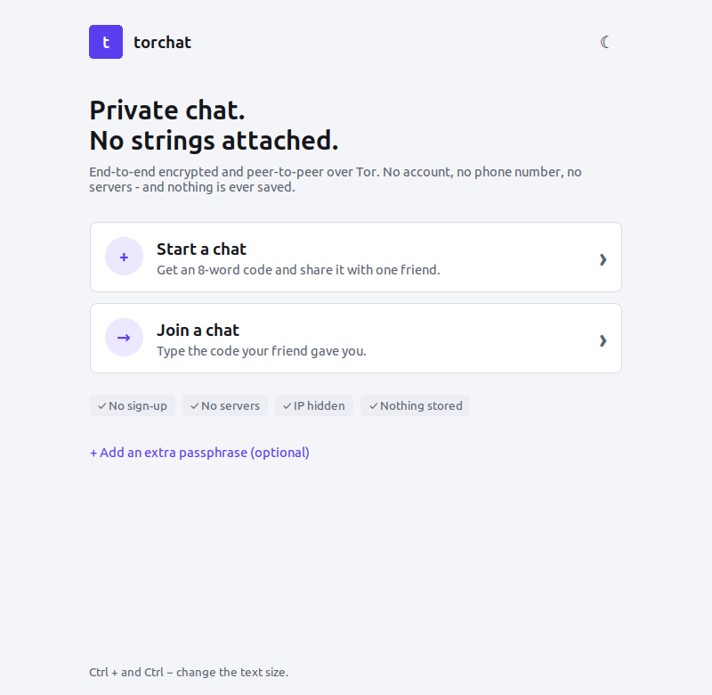
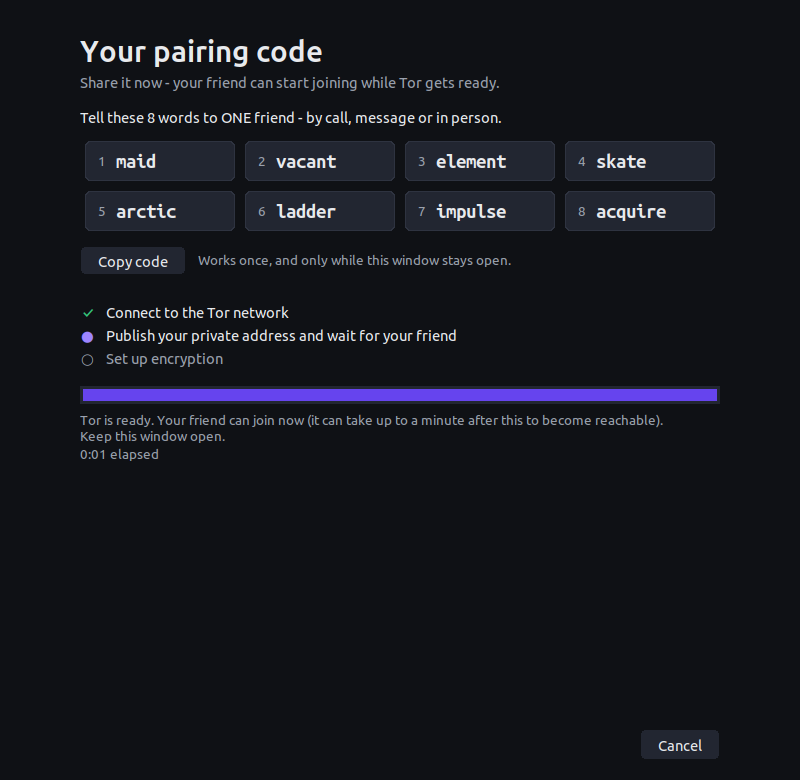
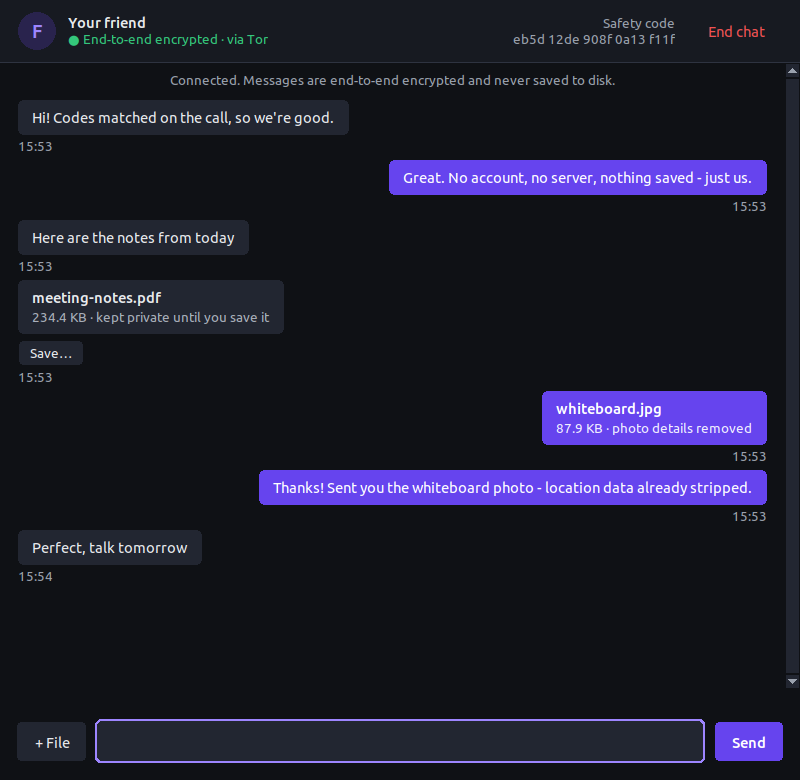

# torchat

**Private chat with anyone in the world. No account. No servers. Nothing saved.**

Share 8 words with a friend and you are connected directly, end-to-end encrypted, over Tor.
Text, photos and documents all travel through the same encrypted channel, and nothing is ever written to disk.

<p>
  
  
  
</p>

## Why torchat

* **No sign-up, no phone number, no email.** An 8-word code is the only thing you share, and it works once.
* **No servers.** Messages go straight from your device to your friend's. There is no company in the middle that can be hacked, log your chats or be shut down.
* **Both IP addresses stay hidden.** The connection runs over a Tor onion service, so neither side learns where the other is. It works behind any home router or office firewall without port forwarding.
* **Strong, modern encryption.** X25519 key exchange, a Signal-style Double Ratchet and ChaCha20-Poly1305. Every message has its own key: stolen keys can't read earlier messages, and the chat heals itself afterwards.
* **Built-in check against eavesdroppers.** Both screens show a short safety code that you compare by phone or in person before anything is sent.
* **Nothing saved.** Chats never touch the disk. Received files wait in a private temporary folder that is wiped when you close the app.
* **Photos are cleaned before they leave.** Location, camera and other hidden details are removed from JPEG and PNG photos. If a photo can't be cleaned, it is not sent.
* **Small enough to check yourself.** One Python file, Tor, and one library (`cryptography`), all from your system's own package manager.
* **Clean, modern window** with dark and light themes, or a simple text screen for phones and servers.

## How it compares

|                                   | torchat                        | Typical messenger app                      |
|-----------------------------------|--------------------------------|--------------------------------------------|
| Account needed                    | No                             | Phone number or email                      |
| Central server                    | None                           | Yes - relays and often stores messages     |
| Who can see your IP address       | Nobody (Tor)                   | The service provider                       |
| Chat history stored               | Never                          | Usually, on the device and/or server       |
| Both people online at once        | Required                       | Not required                               |
| Group chats                       | No (one-to-one only)           | Yes                                        |

## Quick start

1. **Install (once):** `sh setup.sh` - installs Tor, Python 3, the `cryptography` library and window support from your system's package manager, checks that everything works, and creates `start.sh` and `torchat.conf`.
2. **Start:** `sh start.sh` - opens the window (or the text screen on phones and servers).
3. **Connect:** one person picks **Start a chat** and tells the 8 words to one friend. The friend picks **Join a chat** and types them. Compare the safety codes by phone, then chat.

## Devices

| Device | Install and start |
|---|---|
| **Linux** (Debian, Ubuntu, Mint, Kali, Fedora, RHEL, Arch, Manjaro, Alpine, openSUSE) | `sh setup.sh` then `sh start.sh` |
| **macOS** (with [Homebrew](https://brew.sh)) | `sh setup.sh` then `sh start.sh` |
| **Android** (in [Termux](https://termux.dev)) | `sh setup.sh` then `sh start.sh` - opens the text screen |

`python3 start-gui.py` opens the window directly (the same as `python3 torchat.py --gui`). `start.sh` is the better choice because it also applies your `torchat.conf` settings and uses the Python that `setup.sh` set up.

The two people can use different kinds of devices (for example Android and Linux).

## Using the window

* **Enter** sends, **Ctrl+O** sends a file, **Ctrl +** / **Ctrl −** change the text size.
* Right-click a message to copy it.
* **Route** (top of the chat) shows your half of the connection: your entry guard, middle relay(s) and the meeting point, with each relay's country. Your friend's half stays hidden from you, and yours from them. In the text screen, type `/route`.
* The sun/moon button on the start screen switches between dark and light themes.
* **End chat** closes the connection and wipes everything you received.

## Pairing codes

* The code is 8 ordinary words, e.g. `few lawn turkey divide detect undo build desk`. Capitals, spaces and dashes don't matter, and the first 4 letters of each word are enough.
* The last word is a checksum, so a typo is caught instantly with a clear message.
* The code works **once** and only while the host's window stays open. If the host restarts, they get a **new** code - ask for the newest one.
* Tell the code to **one** person only. Anyone who knows it can join before your friend does - that is exactly what the safety-code check is for.
* Optional: add an **extra passphrase** that you agree on over a *different* route than the code. Both of you must enter the same one.

## The safety code (important)

After connecting, both screens show a short code like `4872 46de 93b9 c552 8925`. Read yours to your friend **by phone or in person (not in this chat)** and have them read theirs. If they are identical, nobody is in the middle. If they differ, press **They don't match** and start again.

## Sending photos and documents

* **Window:** **+ File** button (or Ctrl+O). **Text screen:** `/send ~/Pictures/cat.jpg`.
* Up to 50 MB per file. Every file is checked for damage and tampering.
* JPEG and PNG photos up to 25 MB have location, camera and other hidden details removed before sending. A photo that can't be cleaned is **not sent**.
* Documents (PDF, Word, ...) and very large photos are sent unchanged and can contain the author's name or location - they are marked with a note.
* Received files wait in a private temporary folder. Click **Save...** (or `/save 1`) to keep one. **Nothing is opened automatically.** Program-type files (`.exe`, `.apk`, `.sh`, ...) get a warning.
* Everything in the temporary folder is wiped when you close the app.

## Settings (`torchat.conf`)

```
INTERFACE=auto        # auto, gui or text
TOR_CACHE=1           # 1 = faster starts by reusing Tor's public network list; 0 = keep nothing on disk
FIREWALL_80_443=0     # 1 = for networks that only allow web traffic (some schools/offices)
# BRIDGES_FILE=~/bridges.txt
```

## If it won't connect

Run **`python3 torchat.py --selftest`** - it starts a host and a guest on your own device and tells you which step fails.

* **"Tor is stuck at N%"** - your network blocks Tor, or the date/time is wrong. Turn on automatic time. Try another Wi-Fi, mobile data or a VPN.
* **Still blocked?** Get *bridges* from <https://bridges.torproject.org>, save the lines in a text file, install `obfs4proxy` (or `lyrebird`) - Termux: `pkg install obfs4proxy`, Debian/Ubuntu: `sudo apt install obfs4proxy` - and set `BRIDGES_FILE=` in `torchat.conf`.
* **"Host not found" / stays on "searching"** - the host must start first and keep their window open. Every restart makes a **new** code. After the host's Tor is ready it can take up to a minute for the code to become reachable.
* More detail: `python3 torchat.py --debug` prints Tor's log in the terminal.

## Security design

* **Tor onion service:** peer-to-peer, works through any router or firewall, hides both IP addresses, and no server ever sees or stores anything.
* **The code is the key:** the 8 words (77 random bits + a checksum word) are stretched with scrypt into the onion address, a client-authorization key and a handshake secret, so only someone with the code can find or enter the chat.
* **Handshake:** ephemeral X25519, transcript-bound HKDF, mutual key confirmation, and the human-checked safety code before anything is sent.
* **Messages:** Double Ratchet with ChaCha20-Poly1305 - fresh keys for every message, forward secrecy and recovery after a compromise.
* **No web server, no open port:** the app is a window or terminal plus a private unix socket to Tor.
* **Private by default:** nothing is saved except Tor's *public* network list (switch off with `TOR_CACHE=0`). Chats are never written to disk.

## Honest limits

* One-to-one chat only; both people must be online at the same time (there is no server to hold messages).
* It has not had a professional security audit. For life-or-death situations use a tool with a long public track record.
* No app can protect a phone or computer that is already infected, or stop someone looking over your shoulder.
* The very first start is slower while Tor builds its network list; later starts are faster.
* Windows and iPhone are not supported.
